# Living Lake – a Nilgiri hill lake for Wear OS

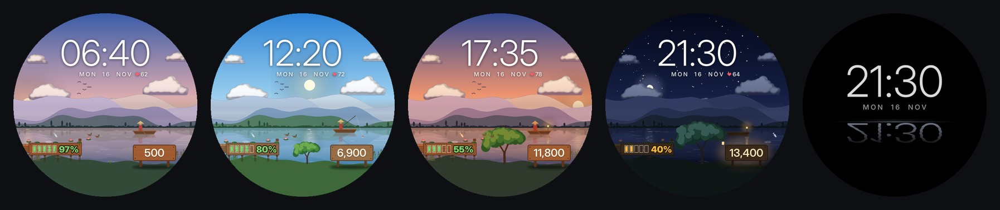

A small Nilgiri hill lake lives on your wrist. The time sits in the sky, and everything else you want to know is painted into the scene: the **battery** on the jetty, your **steps** on a wooden sign, your **day** in a tree that grows as you walk. The light follows the real sun and moon, the lake follows your weather and the Tamil Nadu seasons, and a fisherman, ducks and birds keep it gently alive.

Built in Google's **Watch Face Format 4**, so it runs on **round watches with Wear OS 6 or newer** (Galaxy Watch 4 to 8 and Ultra on One UI 8 Watch, Pixel Watch 2 to 4). Made and tested on a Galaxy Watch 8 (44 mm).

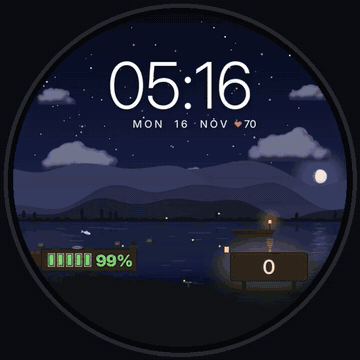

---

## Features

| | |
|---|---|
| ⏱ **Time** | A large, light clock in the sky; follows your 12/24 h setting. Tap → Alarm |
| 📅 **Date** | Under the time. Tap → Alarm |
| 💓 **Heart rate** | A small heart and number after the date. Tap → Heart rate |
| 🔋 **Battery** | Painted blocks and a percentage on the jetty plank: green, amber below 50 %, red below 20 %. Tap → Battery |
| 👣 **Steps** | A big carved number on the wooden sign. Tap → your steps app |
| 🌳 **The tree** | Grows through nine stages as your steps add up and blooms at your goal. **Droops a little when you fall behind** (from 10 am), perks up as you catch up |
| 🏮 **Goal evening** | On days you reach your goal, paper lanterns drift up from the lake after 6 pm |
| 🍾 **Messages** | Unread notifications float in as one to three bottles. Tap → Messages |
| 🎣 **Lake life** | The fisherman casts by day, rows at dawn and dusk and moors with a lamp at night. **Tap the boat** and he lands a catch. Fish jump, ducks drift, a flock of birds crosses the sky |
| 🐐 **Surprises** | Some dawns a **Nilgiri tahr** and its kid stand on the ridge; some afternoons **crows** fly in, wheel once round the hills and fly away |
| ☀️🌙 **Sun, moon & weather** | The sun and moon follow the real time on a low arc, the moon in its real phase, light glinting on the water; live rain, storms and fog |
| 🍂 **Tamil Nadu seasons** | Golden konrai and dry grass in summer, towering clouds in the southwest monsoon, lotus in the northeast monsoon, misty mornings with storks and pelicans in the cool season |
| ➰ **Edge bars** | Two optional curved bars along the edges for any complication you like (weather, water, floors...). Empty and invisible by default |
| 🌑 **Always-on** | The scene fades away; the time grows and glides to the centre with its reflection on still water. About 6 % of pixels lit |

| Dawn | Day | Golden hour | Night | Always-on |
|---|---|---|---|---|
| 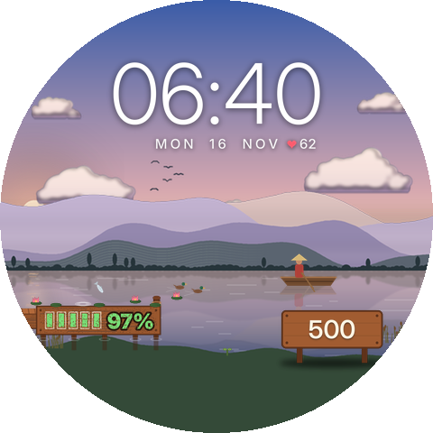 | 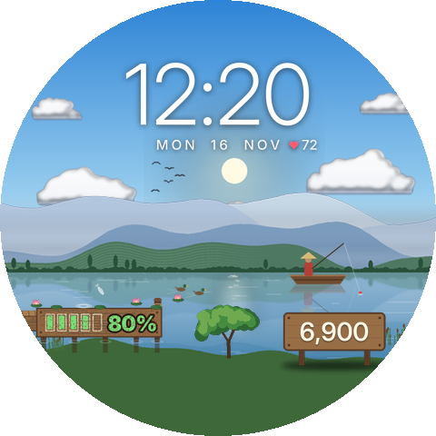 | 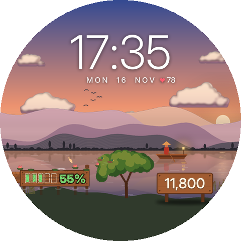 | 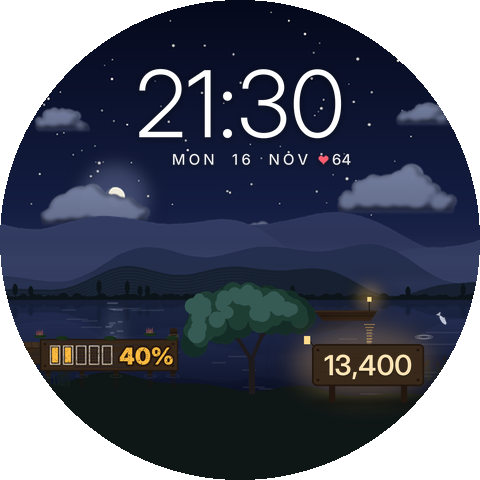 | 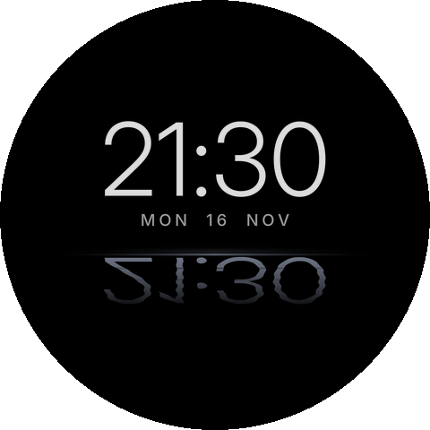 |

| Summer | Southwest monsoon | Cool season | Rain | Storm |
|---|---|---|---|---|
| 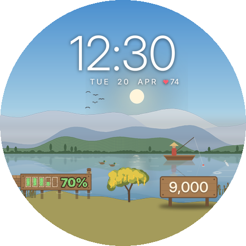 | 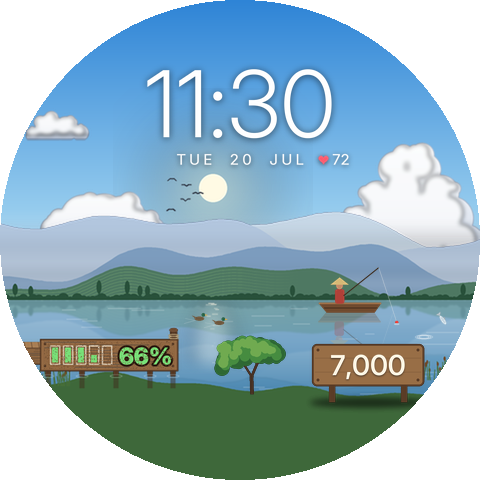 | 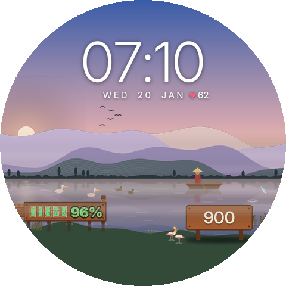 | 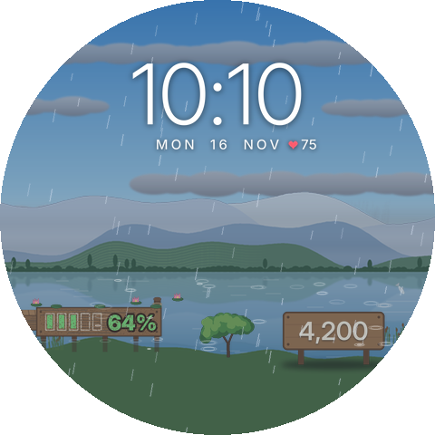 | 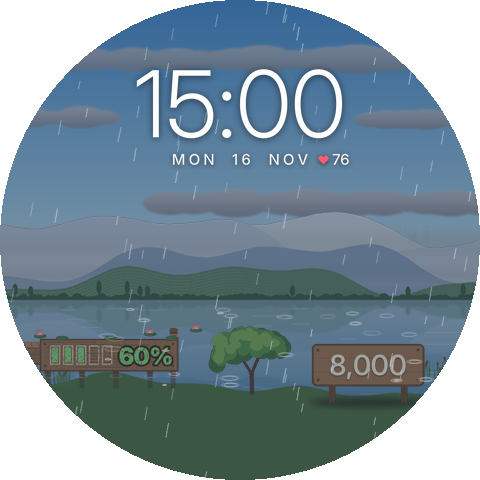 |

| Goal reached | Behind on steps | Goal evening | Nilgiri tahr | Crows |
|---|---|---|---|---|
| 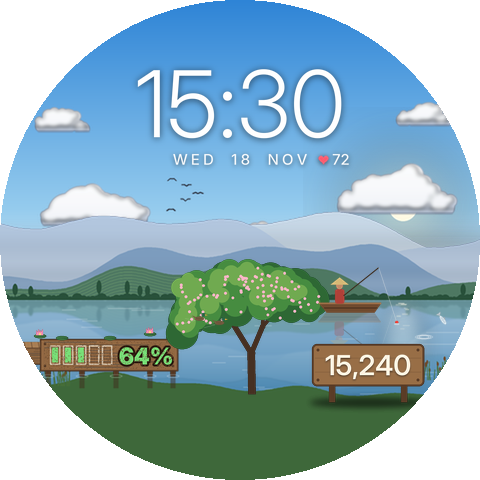 | 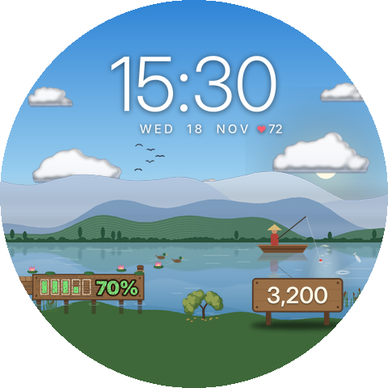 | 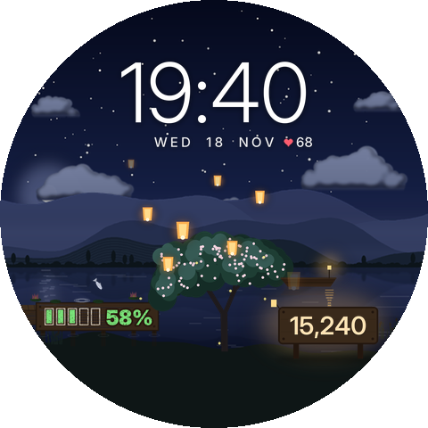 | 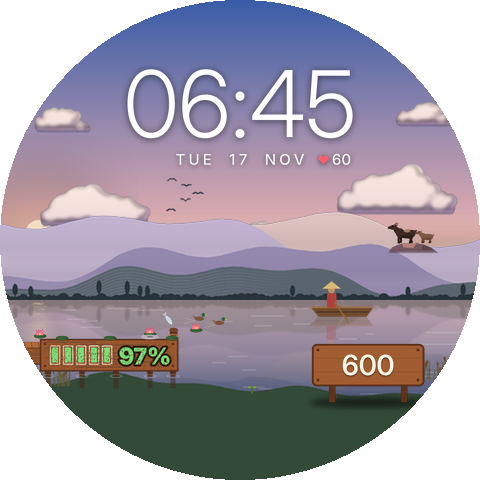 | 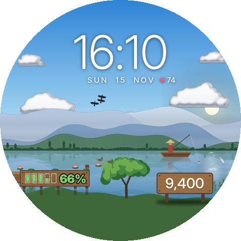 |

| Messages | Edge bars | Anatomy |
|---|---|---|
| 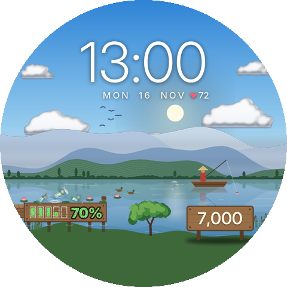 | 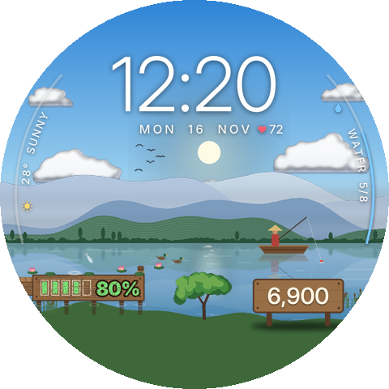 | 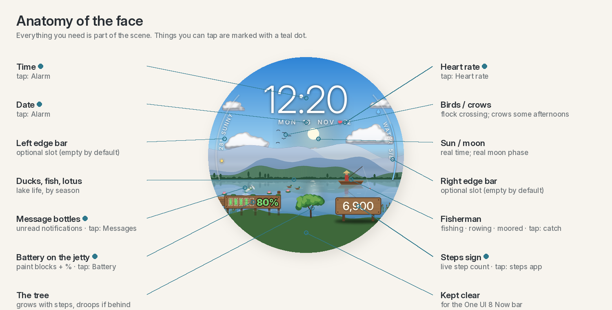 |

> Screenshots are renders of the face; on your wrist it's live and animated. See the **[demo video](media/demo.mp4)** and the **[full guide (PDF)](docs/Living-Lake-guide.pdf)**, which explains every function and animation.

## Customize

Touch and hold the face → **Customize**:

- **Heart rate** on/off
- **Lake life and birds** on/off (the boat, fish, ducks, birds, crows, tahr) for a stiller lake
- **Tree droops when behind on steps** on/off
- **Steps sign**: which app opens when you tap it
- **Left and right edge bars**: any complication, or leave them empty

Note: the seasons follow Tamil Nadu's months, so they won't match the weather everywhere.

---

## Install

1. Download **`LivingLake-watchface-v1.7.apk`** from the [**Releases**](../../releases) page.
2. Follow **[INSTALL.md](INSTALL.md)**: about 10 minutes the first time. Do it **from your Android phone with a free app (no computer needed)**, or with one `adb install` command from Windows, macOS or Linux.
3. On the watch: touch and hold the face → swipe to **+ Add watch face** → **Living Lake**.

**Requirements:** a round watch with **Wear OS 6 or newer** (on Samsung: One UI 8 Watch). Older software can't load Watch Face Format 4. Weather, moon phase, heart rate and step goal come from your watch and phone (Samsung Health / your fitness app and the weather service).

---

## Build it yourself

The watch face has **no code**: it's an XML file plus images and fonts.

```
watchface/src/main/
  AndroidManifest.xml
  res/raw/watchface.xml      ← the whole face (Watch Face Format 4)
  res/drawable/*.png         ← artwork (sky, hills, lake, tree, boat, birds, weather, seasons)
  res/font/*.ttf             ← Inter subsets (SIL OFL) + the mirrored reflection font
tools/                       ← Python scripts that draw the artwork and write the XML
docs/                        ← the full guide (PDF)
media/                       ← demo video and GIF
```

- Rebuild every image and the XML in about 40 seconds: see [tools/README.md](tools/README.md)
- Package and sign with **your own** key: `tools/build_apk.sh`

Validate against the official schema from [google/watchface](https://github.com/google/watchface).

---

## Credits & licences

- **Design and artwork:** © John Jitto M. Artwork licensed under **CC BY-NC-SA 4.0** (see [LICENSE-ARTWORK](LICENSE-ARTWORK)): share and remix with credit, not for sale.
- **Scripts & XML:** MIT (see [LICENSE](LICENSE)).
- **Font:** [Inter](https://github.com/rsms/inter) by The Inter Project Authors, SIL Open Font License 1.1 (see `fonts-licenses/`). The watch face uses subsets of it and a mirrored version for the reflection.
- Not affiliated with or endorsed by Samsung or Google.

Provided **as-is**: a personal project, not an official app. Install at your own risk.
